# TV Browser: System Architecture Document

## 1. System Overview & Design Philosophy

**TV Browser** is a high-performance, lightweight web browser built natively for **Samsung 2022 Smart TVs (Tizen 6.5, Chromium M85)**.

The design philosophy adheres to four foundational pillars:
1. **Truth in Capability**: No fabricated browser extensions, no fake ad-blocking stats, and truthful handling of cross-origin framing constraints.
2. **Television-First UX**: Premium aesthetic inspired by modern minimalist interfaces (Arc, Safari, Brave), readable at a 10-foot distance, with 100% remote-control coverage.
3. **Rigorous Resource Budgeting**: Tailored for constrained TV hardware (~1.5GB system RAM, ARM Cortex-A53 quad-core CPU). Zero memory leaks, lazy-loaded components, and automatic background tab suspension.
4. **Resilience & Safe Recovery**: Fail-open design, infinite redirect loop protection, and one-click Safe Mode restoration.

```mermaid
graph TD
    RemoteInput[Samsung Smart Remote / IR] -->|KeyEvents / TV Input Device API| InputEngine[Input & Focus Controller]
    InputEngine -->|D-Pad / Enter| SpatialNav[Spatial Navigation Manager]
    InputEngine -->|Pointer Toggle| VirtualPointer[Virtual Mouse Cursor]
    InputEngine -->|Text Input| VirtualKeyboard[On-Screen TV Keyboard]

    AppShell[App Shell & Layout] --> HeaderToolbar[Auto-Hiding Toolbar]
    AppShell --> TabBar[Session & Tab Bar]
    AppShell --> ViewportManager[Tri-Mode Viewport Engine]
    AppShell --> StartPage[Instant Local Start Page]

    ViewportManager -->|Mode 1: Embed| IframeSurface[Sandboxed Iframe Viewport]
    ViewportManager -->|Mode 2: Clean Read| ReaderEngine[Reader & Content Extractor]
    ViewportManager -->|Mode 3: Local Portals| LocalApps[Local Web Apps & Test Suite]

    SecurityCore[Security & Privacy Engine] --> NavGuard[Navigation Guard & Scheme Validator]
    SecurityCore --> PopupShield[Popup & Window.open Neutralizer]
    SecurityCore --> CosmeticFilter[Cosmetic Ad & Tracker Suppressor]
    SecurityCore --> SiteAllowlist[Site Exceptions & Strict Mode]

    NativeBridge[Tizen Platform Services] --> DownloadAPI[Tizen Download Manager]
    NativeBridge --> StorageAPI[Storage Manager: LocalStorage + IDB]
    NativeBridge --> LifecycleAPI[Tizen Application Lifecycle]
```

---

## 2. Core Subsystems

### 2.1 Input & Navigation Subsystem (`src/input/` & `src/navigation/`)
- **Key Event Normalization**: Normalizes Samsung TV keycodes (e.g. Return `10009`, Red `403`, Green `404`, Yellow `405`, Blue `406`, Play/Pause `10252/415/19`) alongside standard W3C keys (`ArrowUp`, `ArrowDown`, `ArrowLeft`, `ArrowRight`, `Enter`).
- **Spatial Focus Engine**:
  - Maintains an active container scope (`#start-page`, `#toolbar`, `#settings-modal`, `#dialog`).
  - Scans focusable elements (`button`, `input`, `[tabindex="0"]`, `.focusable`).
  - Calculates Euclidean distance and directional projection between center points to determine the optimal focus target.
  - Handles automatic scroll-into-view with smooth easing.
- **Virtual Pointer Mode**:
  - Smooth 60 FPS virtual cursor rendered on an isolated GPU-composited overlay.
  - Frame-delta time acceleration with minimum and maximum velocity bounds.
  - Automatically activates on web pages allowing pointer clicks.
- **On-Screen TV Keyboard**:
  - High-contrast, large-key layout designed specifically for TV remotes.
  - Features standard letters, numeric row, symbols page, URL shortcuts (`.com`, `.org`, `https://`), Backspace, and Clear.
  - Seamlessly integrates with physical input when an external keyboard is connected.

### 2.2 Tri-Mode Viewport Engine (`src/browser/`)
Due to platform security restrictions where third-party websites restrict iframe embedding via `X-Frame-Options` and `CSP frame-ancestors`, TV Browser provides three coordinated modes:
1. **Direct Embed Mode**: Renders compatible sites in an isolated `<iframe>` with strict sandbox flags (`allow-scripts allow-forms allow-same-origin`) protecting against unauthorized window opens and top-level navigation hijack.
2. **Reader & Article Mode**: For news, reference articles, blogs, and documentation, the engine uses the TV's network capability to fetch content, strip clutter, remove ads/trackers, format for 10-foot TV reading with high-contrast typography, and render securely.
3. **Local Portals & Verification Suite**: Curated directory of TV-optimized services, tools, and a built-in diagnostic test suite for validating ad-blocking, popups, downloads, and video playback.

### 2.3 Ad & Popup Protection Engine (`src/adblock/` & `src/security/`)
- **5-Layer Architecture**:
  1. **Layer 1: URL Scheme & Navigation Guard**: Rejects dangerous schemes (`javascript:`, `data:`, `file:`, `blob:` navigation) and known malicious tracking domains.
  2. **Layer 2: Sandbox Isolation**: Blocks popunders, iframe escape attempts, and unprompted window hijacking.
  3. **Layer 3: Cosmetic Filter Engine**: High-performance CSS stylesheet injecting over 250 verified element-hiding selectors for ad wrappers, sponsored widgets, sticky floating banners, and cookie consent popups. Bounded MutationObserver prevents DOM bloat.
  4. **Layer 4: Popup Shield**: Overrides and neutralizes `window.open`, logging blocked attempts in the diagnostics counter.
  5. **Layer 5: Per-Site Configuration**: Allows toggling ad blocking, enabling Strict Mode, or adding trusted sites to an allowlist.
- **Protection Metrics**: Distinct, verified counters for Blocked Popups, Cosmetically Hidden Elements, and Blocked Unsafe Schemes. No fabricated numbers.

### 2.4 Download Manager (`src/downloads/`)
- Interacts directly with `tizen.download` when running on Tizen OS.
- Validates capability via `tizen.systeminfo.getCapability('http://tizen.org/feature/download')`.
- Manages download lifecycle: Start, Progress Tracking, Pause, Resume, Cancel, Completion.
- Stores history in persistent storage with file name, size, MIME type, and local storage path (`downloads/` directory).
- Gracefully handles mock/browser preview mode when running during development on Mac.

### 2.5 Multi-Tab & Session Management (`src/tabs/`)
- Maximum 3 concurrent tabs (configurable in settings down to 1 for memory-constrained models).
- **Single Active Rendering Surface**: Only the active tab maintains an active DOM/iframe viewport.
- **Suspension**: Background tabs are automatically serialized (URL, title, timestamp, favicon) and detached from the DOM to eliminate background CPU/RAM consumption.
- Restores tabs on demand when the user switches to them.
- Private Browsing Mode ensures history and session state are purged immediately upon tab closure.

### 2.6 Storage, Settings & Performance (`src/storage/`, `src/settings/`, `src/performance/`)
- **Persistent Preferences**: JSON schema validated settings for theme, default search engine (DuckDuckGo, Google, Bing, Startpage), user agent mode, tab limit, ad-block strictness, and telemetry HUD.
- **Memory Optimization**:
  - Small DOM footprint (< 150 DOM nodes in base shell).
  - All icons rendered as lightweight inline vector SVGs; no heavy external icon webfonts.
  - Zero continuous background timers; event-driven reactive updates.
- **Safe Mode**: Fail-safe boot flag that disables optional CSS filters and restores factory preferences if multiple crash loops are detected.

---
